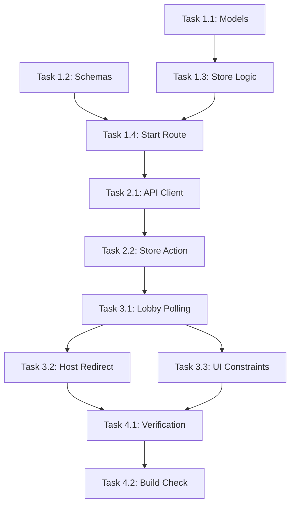

# Implementation Tasks - Room Creation & Joining (Slice 1)

This task list tracks the step-by-step implementation and verification steps for Slice 1.

---

## Task Checklist

### Phase 1: Shared Models & Backend
- [ ] **Task 1.1: Extend Data Models**
  - Update `Participant` and `Room` structures in `backend/src/models/game.ts` to include `hostId: string`.
  - Add `"active"` to `RoomStatus` type.
- [ ] **Task 1.2: Update Validation Schemas**
  - Modify `createRoomSchema` and `joinRoomSchema` in `backend/src/api/schemas.ts` to trim player names and reject empty strings.
  - Add `startGameSchema` in `backend/src/api/schemas.ts` validating the requesting player's `participantId`.
- [ ] **Task 1.3: Update Room Store Logic**
  - Update `createRoom()` in `backend/src/services/roomStore.ts` to record `hostId` matching the creator's ID.
  - Implement validation inside `joinRoom()` and `createRoom()` to verify name trimming.
  - Ensure `joinRoom()` throws or returns a descriptive error (e.g. "Room not found") when the room does not exist.
  - Implement `startGame(code, hostParticipantId)` to validate room status, minimum players (>=2), host authorization, and transition status to `"active"`.
- [ ] **Task 1.4: Implement Start Route**
  - Create route handler `POST /rooms/:code/start` in `backend/src/api/rooms.ts`.
  - Wire it to `startGame()` service method and handle exceptions.

---

### Phase 2: Frontend API & Store
- [ ] **Task 2.1: Align Frontend Models & API Client**
  - Add `hostId` to `RoomSnapshot` interface in `frontend/src/services/api.ts`.
  - Add `startGame(code, participantId)` fetch request helper in `frontend/src/services/api.ts`.
- [ ] **Task 2.2: Implement Store Actions**
  - Add `startGame()` method in `frontend/src/state/roomStore.ts` store class.
  - Bind it to set state and handle loading indicators.
- [ ] **Task 2.3: Frontend Validation on Join**
  - Update `frontend/src/pages/JoinRoomPage.tsx` to validate that the room code is not empty or whitespace-only before submitting the form. If empty, show a local validation error: `"Room code cannot be empty"`.

---

### Phase 3: Frontend Lobby UI & Polling
- [ ] **Task 3.1: Lobby Polling Mechanism**
  - Update `frontend/src/pages/LobbyPage.tsx` with a `useEffect` setting up `setInterval` to call `roomStore.fetchRoom()` every 2000ms.
  - Ensure the interval is cleared on component unmount.
- [ ] **Task 3.2: Host Navigation Trigger**
  - Detect when fetched `room.status === "active"` and automatically redirect all participants to `/game` using `navigate`.
- [ ] **Task 3.3: Host UI Rules**
  - Hide or disable the "Start Game" action for guest players, replacing it with a message: *"Waiting for host to start the game..."*
  - Disable the "Start Game" button for hosts when `participants.length < 2`, displaying: *"Need at least 2 players to start."*

---

### Phase 4: Verification & Cleanup
- [ ] **Task 4.1: Manual Multi-tab Verification**
  - Verify room creation, lobby updates within 2 seconds, guest start button omission, and dual-client auto-navigation to `/game`.
- [ ] **Task 4.2: Build & Lint Validation**
  - Run `npm run build` in both frontend and backend directories.
  - Run `npm test` to verify Vitest tests execute successfully.

---

## Dependencies & Path

