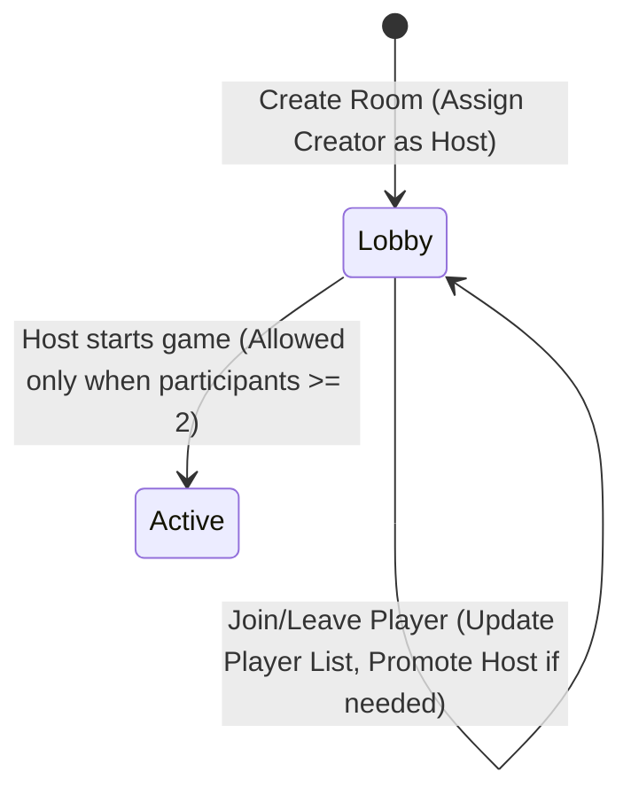

# Data Model: Room Setup & Lobby

This document describes the schema, constraints, and state transitions of the entities involved in the Room Setup & Lobby feature.

## Entities

### 1. Participant
Represents a player in a game room.

| Field | Type | Description | Validation |
|-------|------|-------------|------------|
| `id` | `string` | Unique identifier (UUID v4) | Required, UUID format |
| `name` | `string` | Display name selected by the player | Required, 1-30 chars, non-empty after trimming, unique within the room |
| `joinedAt` | `string` | Timestamp of when the player joined | Required, ISO 8601 datetime format |

### 2. Room
Represents a drawing game room instance.

| Field | Type | Description | Validation |
|-------|------|-------------|------------|
| `code` | `string` | 4-character unique room code | Required, uppercase alphanumeric, excluding confusing characters (like 0, 1, I, O) |
| `status` | `RoomStatus` | Current phase of the room | Required, value must be `"lobby"` (extendable to `"active"`, `"round_end"`, etc. in future phases) |
| `hostId` | `string` | ID of the participant who is the host | Required, must match `id` of a participant in `participants` |
| `participants` | `Participant[]` | List of players currently in the room | Minimum 1 participant upon creation |
| `createdAt` | `string` | Timestamp of room creation | Required, ISO 8601 datetime format |
| `updatedAt` | `string` | Timestamp of last state modification | Required, ISO 8601 datetime format |

## State Transitions

