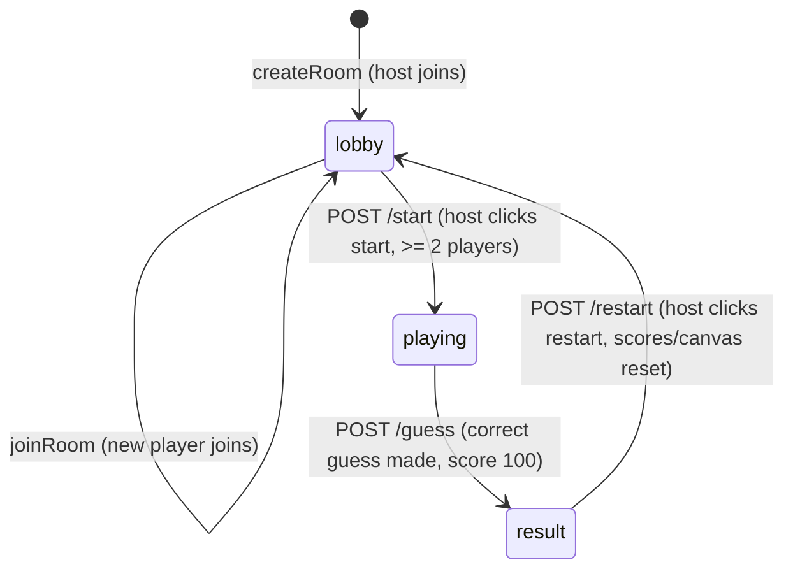

# Data Model & State Transitions: Scribble Multiplayer Drawing Game

## Entities & Schemas

### 1. Participant
Represents an active player in a room.
- `id` (UUID): Unique player identifier generated on create/join.
- `name` (string): Trimmed, non-empty player name.
- `joinedAt` (ISO timestamp): Time the participant connected.

### 2. Guess
Represents a guess submitted by a guesser.
- `participantId` (string): ID of the guesser.
- `participantName` (string): Display name of the guesser.
- `text` (string): Trimmed, non-empty guess text.
- `isCorrect` (boolean): `true` if guess matched `secretWord` case-insensitively.
- `timestamp` (ISO timestamp): Time guess was submitted.

### 3. Line
Represents a single stroke on the canvas.
- `color` (string): Hex color code or name.
- `width` (number): Pen stroke width.
- `points` (array of `{x, y}`): Coordinates of points in the stroke.

### 4. Room
In-memory representation of a game session.
- `code` (string): Unique 4-character uppercase alphanumeric string.
- `status` (string): `"lobby" | "playing" | "result"`.
- `hostId` (string): Participant ID of the room host.
- `participants` (array of Participants): Players in the room.
- `drawerId` (string | null): Participant ID of the drawer.
- `secretWord` (string | null): The target word for the round.
- `canvasData` (string): JSON stringified array of `Line` objects.
- `guesses` (array of Guesses): Complete guess history.
- `scores` (map of participantId to number): Score mapping.

---

## State Transition Diagram

