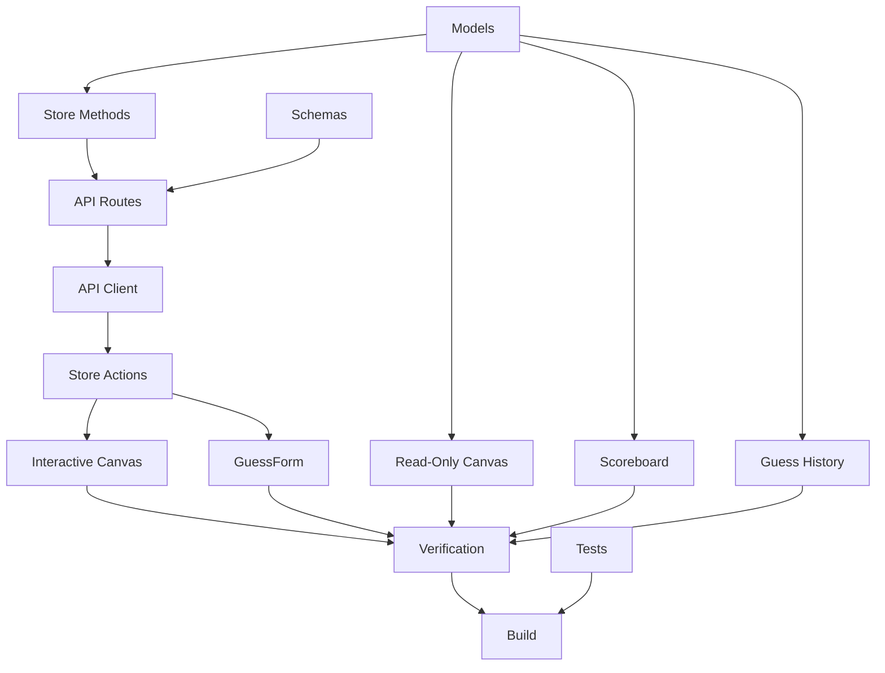

# Implementation Tasks - Gameplay Interaction (Slice 3)

This task list tracks the step-by-step implementation and verification steps for Slice 3.

---

## Task Checklist

### Phase 1: Shared Models & Backend
- [ ] **Task 1.1: Extend Data Models**
  - Add `Point`, `DrawingStroke`, `Guess` types to `backend/src/models/game.ts`.
  - Add `guesses`, `scores`, `drawing`, `correctGuessers` to `Room`.
  - Add `guesses`, `scores`, `drawing` to `RoomSnapshot`.
  - Align `RoomSnapshot` in `frontend/src/services/api.ts`.

- [ ] **Task 1.2: Add Validation Schemas**
  - Add `submitGuessSchema` in `backend/src/api/schemas.ts` (participantId, text trimmed min 1).
  - Add `drawingUpdateSchema` in `backend/src/api/schemas.ts` (participantId, strokes array).

- [ ] **Task 1.3: Implement Room Store Methods**
  - Initialize `guesses`, `scores`, `drawing`, `correctGuessers` in `createRoom()`.
  - Implement `submitGuess(code, participantId, text)` with validation and scoring.
  - Implement `updateDrawing(code, participantId, strokes)`.
  - Implement `clearDrawing(code, participantId)`.
  - Update `toRoomSnapshot()` to include new fields.

- [ ] **Task 1.4: Add API Routes**
  - Add `POST /rooms/:code/guess` route handler.
  - Add `POST /rooms/:code/draw` route handler.
  - Add `POST /rooms/:code/clear` route handler.
  - All return updated room snapshot.

---

### Phase 2: Frontend API & Store
- [ ] **Task 2.1: Add API Client Methods**
  - Add `submitGuess()` to `frontend/src/services/api.ts`.
  - Add `updateDrawing()` to `frontend/src/services/api.ts`.
  - Add `clearDrawing()` to `frontend/src/services/api.ts`.

- [ ] **Task 2.2: Add Store Actions**
  - Add `submitGuess()` method in `frontend/src/state/roomStore.ts`.
  - Add `updateDrawing()` method.
  - Add `clearDrawing()` method.

---

### Phase 3: Frontend UI Components
- [ ] **Task 3.1: Implement Interactive Canvas (Drawer)**
  - Replace drawer canvas placeholder with interactive `<canvas>` in `GamePage.tsx`.
  - Implement mouse event handlers (mousedown, mousemove, mouseup) for drawing.
  - Submit completed strokes to backend on mouseup.
  - Add "Clear Canvas" button that calls `clearDrawing()`.

- [ ] **Task 3.2: Implement Read-Only Canvas (Guesser)**
  - Render drawing strokes from `room.drawing` on a read-only `<canvas>`.
  - Re-render on each poll update via existing 2s polling loop.

- [ ] **Task 3.3: Wire Up GuessForm**
  - Modify `GuessForm.tsx` to call `roomStore.submitGuess()` on submit.
  - Disable input if player is drawer or has already guessed correctly.
  - Clear input after successful submission.

- [ ] **Task 3.4: Implement Live Scoreboard**
  - Update `Scoreboard.tsx` to display `room.scores` for each participant.
  - Show "0" for participants without a score entry.

- [ ] **Task 3.5: Implement Guess History Panel**
  - Update `ResultPanel.tsx` (or rename to `GuessHistory.tsx`) to display `room.guesses`.
  - Show participant name, guess text, and correct/incorrect indicator.

---

### Phase 4: Verification & Cleanup
- [ ] **Task 4.1: Write Backend Unit Tests**
  - Test empty guess rejection.
  - Test case-insensitive correct match.
  - Test drawer guess rejection.
  - Test scoring: correct = 100, duplicate = 0.
  - Test drawing: drawer can update/clear, non-drawer rejected.

- [ ] **Task 4.2: Manual Multi-tab Verification**
  - Verify drawer can draw and guesser sees strokes within 2s.
  - Verify clear canvas works for both tabs.
  - Verify guess submission, validation, history, and scoring.

- [ ] **Task 4.3: Build Validation**
  - Run `npm test` in both directories.

---

## Dependencies & Path

