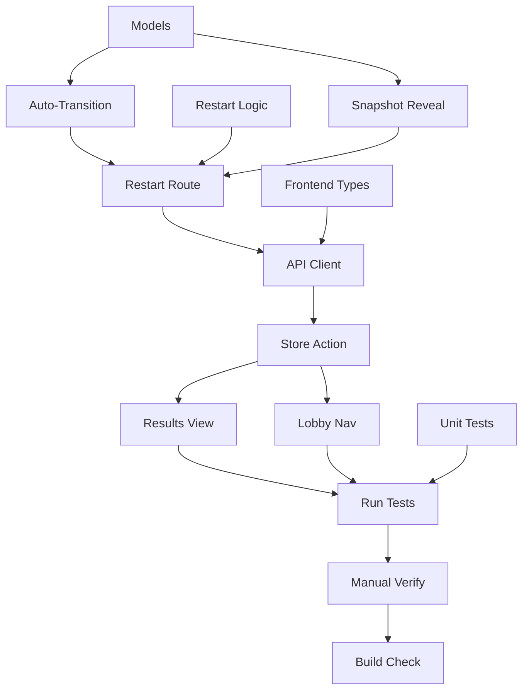

# Implementation Tasks — Result, Restart & Final Validation (Slice 4)

This task list tracks the step-by-step implementation and verification steps for Slice 4.

---

## Task Checklist

### Phase 1: Shared Models & Backend
- [ ] **Task 1.1: Extend RoomStatus**
  - Add `"results"` to the `RoomStatus` type in `backend/src/models/game.ts`:
    ```typescript
    export type RoomStatus = "lobby" | "active" | "results";
    ```

- [ ] **Task 1.2: Auto-Transition to Results on All Correct**
  - Modify `submitGuess()` in `backend/src/services/roomStore.ts`.
  - After a correct guess, check if all non-drawer participants are in `correctGuessers`.
  - If so, set `room.status = "results"`.

- [ ] **Task 1.3: Implement Restart Game Logic**
  - Add `restartGame(code, hostParticipantId)` in `backend/src/services/roomStore.ts`:
    - Validate room exists (`404`).
    - Validate caller is host (`403`).
    - Validate status is `"results"` (`400`).
    - Reset: `status = "lobby"`, clear `drawing`, `guesses`, `scores`, `secretWord`, `drawerId`, `correctGuessers`.
    - Preserve `participants` array.
    - Save and return cloned room.

- [ ] **Task 1.4: Reveal Secret Word in Results**
  - Modify `toRoomSnapshot()` in `backend/src/services/roomStore.ts`.
  - Include `secretWord` for all viewers when `status === "results"`.

- [ ] **Task 1.5: Add Restart API Route**
  - Add `POST /rooms/:code/restart` in `backend/src/api/rooms.ts`.
  - Parse `{ participantId }` from body (reuse `participantActionSchema`).
  - Call `restartGame()` and return updated snapshot.

---

### Phase 2: Frontend API & Store
- [ ] **Task 2.1: Update Frontend Types**
  - Update `RoomSnapshot.status` in `frontend/src/services/api.ts`:
    ```typescript
    status: "lobby" | "active" | "results";
    ```

- [ ] **Task 2.2: Add Restart API Client Method**
  - Add `restartGame(code, participantId)` to `frontend/src/services/api.ts`.

- [ ] **Task 2.3: Add Restart Store Action**
  - Add `restartGame()` method in `frontend/src/state/roomStore.ts`.
  - Validate `room` and `participantId` are set.
  - Call `api.restartGame()`, update snapshot, return room.

---

### Phase 3: Frontend UI — Results View
- [ ] **Task 3.1: Add Results View to GamePage**
  - In `frontend/src/pages/GamePage.tsx`, when `room.status === "results"`:
    - Render a results section with:
      - Correct word displayed prominently.
      - `Scoreboard` component (already shows final scores).
      - `ResultPanel` component (already shows guess history).
      - Guess history only shows to non-drawer after results. Drawer can see all the time.
    - If viewer is host: show **"Restart Game"** button calling `roomStore.restartGame()` then navigating to `/lobby`.
    - If viewer is not host: show **"Waiting for host to restart..."** message.

- [ ] **Task 3.2: Handle Lobby Navigation on Restart**
  - In the polling `useEffect` of `GamePage.tsx`, add a check: if `room.status === "lobby"`, navigate to `/lobby`.

---

### Phase 4: Verification & Cleanup
- [ ] **Task 4.1: Write Backend Unit Tests**
  - Add tests in `backend/src/services/roomStore.test.ts` for:
    - All guessers correct triggers `"results"` status.
    - Results snapshot reveals secret word to all viewers.
    - `restartGame` clears round state and preserves participants.
    - Non-host gets `403` on restart.
    - Restart from non-results state throws `400`.

- [ ] **Task 4.2: Run All Tests**
  - Run `npm test` in both `backend/` and `frontend/` directories.

- [ ] **Task 4.3: Manual Multi-tab Verification**
  - Verify results view shows correct word, scores, and guess history for both host and guest.
  - Verify host can restart and both players return to lobby with preserved participant list.
  - Verify non-host cannot see restart button.
  - Verify host can start a new game from lobby after restart.

- [ ] **Task 4.4: Build Validation**
  - Run `npm run build` in both frontend and backend directories (if build scripts exist).

---

## Dependencies & Path

